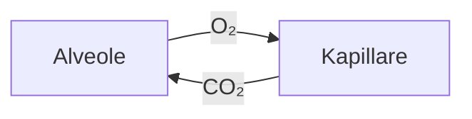

# Atmung

Die Atmung dient dem **Gasaustausch**: Sauerstoff wird aufgenommen, Kohlendioxid abgegeben. Siehe auch [[COPD|chronisch obstruktive Lungenerkrankung]] und [[Asthma bronchiale]].
Dieser Absatz hat einen einfachen Zeilenumbruch, der wie in Obsidian sichtbar bleibt.

#lernzettel #anatomie

## Anatomie der Atemwege

![[Atemwege.svg|320]]
*Abb.: Aufbau der oberen und unteren Atemwege*

Man unterscheidet **obere Atemwege** (Nase, Rachen, Kehlkopf) und **untere Atemwege** (Luftröhre, Bronchien, Bronchiolen, Alveolen). ^anatomie1

%%Kommentar für mich: Bild noch durch eigenes ersetzen%%

### Atemmechanik

Bei der Einatmung kontrahiert das ==Zwerchfell== und flacht ab. Der Brustraum vergrößert sich, der Druck sinkt und Luft strömt ein.

- Einatmung (Inspiration): aktiv
	- Zwerchfell
	- äußere Zwischenrippenmuskeln
- Ausatmung (Exspiration): in Ruhe passiv

### Normwerte

| Parameter | Erwachsene | Kinder (1–5 J.) |
| --- | --- | --- |
| Atemfrequenz | 12–20 /min | 20–30 /min |
| SpO₂ | ≥ 95 % | ≥ 95 % |
| Atemzugvolumen | ca. 500 ml | ca. 7 ml/kg |

> [!info] Merke
> Das Atemminutenvolumen ergibt sich aus $AMV = AF \times AZV$, also etwa $15 \times 0{,}5\,l = 7{,}5\,l/min$.

## Gasaustausch

Der Gasaustausch findet in den Alveolen durch **Diffusion** statt.[^1]

$$
p_{O_2,\,alveolär} \approx 100\,mmHg
$$



```dataview
TABLE status FROM #atmung
```

Zusammenfassung
---

- [x] Anatomie gelernt
- [ ] Normwerte auswendig

[^1]: Diffusion: Teilchenbewegung entlang eines Konzentrationsgefälles.
